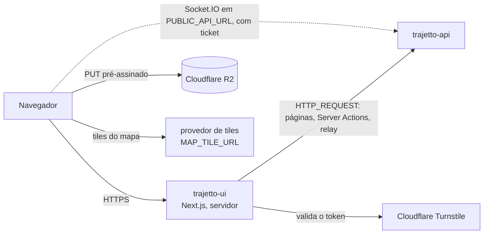

# Trajetto — Web

<p align="center">
  
  
  
  
  
  
  
  
  
  
  
  
  
  
  
  
  
</p>

Painel web e site público do Trajetto. Este repositório contém:

- o painel das transportadoras (`/dashboard`);
- o painel da equipe Trajetto (`/admin`);
- as páginas do motorista no navegador (`/driver`);
- o site público, com blog e páginas legais em MDX;
- o portal de documentação da API (`/docs`);
- as páginas públicas de rastreio (`/acompanhar`) e de conferência de
  comprovante (`/verificar`).

> Software proprietário. Leia a [Licença](#licença) antes de copiar qualquer
> coisa deste repositório.

## Sumário

- [Documentação](#documentação)
- [O Trajetto em 1 minuto](#o-trajetto-em-1-minuto)
- [Fronteiras deste repositório](#fronteiras-deste-repositório)
- [Onde a web fica na arquitetura](#onde-a-web-fica-na-arquitetura)
- [Stack e por que cada peça](#stack-e-por-que-cada-peça)
- [Como o código está organizado](#como-o-código-está-organizado)
- [Rodando localmente](#rodando-localmente)
- [Variáveis de ambiente](#variáveis-de-ambiente)
- [Scripts](#scripts)
- [Sessão, empresa e acesso](#sessão-empresa-e-acesso)
- [Integrações](#integrações)
- [Padrões para escrever código](#padrões-para-escrever-código)
- [Testes](#testes)
- [Depuração](#depuração)
- [Build, imagem e deploy](#build-imagem-e-deploy)
- [Desenvolvimento, staging e produção](#desenvolvimento-staging-e-produção)
- [Solução de problemas](#solução-de-problemas)
- [Decisões e limites conhecidos](#decisões-e-limites-conhecidos)
- [Licença](#licença)

## Documentação

| Documento                                                        | Conteúdo                                                                                                                                                                                                                        |
| ---------------------------------------------------------------- | ------------------------------------------------------------------------------------------------------------------------------------------------------------------------------------------------------------------------------- |
| [`docs/arquitetura.md`](docs/arquitetura.md)                     | stack, mapa do código, rotas, acesso, fluxo de dados, cache do react-query, tempo real, configuração em runtime, segurança e CSP, versão do build, contrato com a API, MDX e portal `/docs`, padrões de tela, tema e desempenho |
| [`docs/testes.md`](docs/testes.md)                               | suítes, comandos, o que cada uma prova, regras para escrever testes, cobertura, mutação e CI                                                                                                                                    |
| [`docs/deploy.md`](docs/deploy.md)                               | fluxo `staging` → `main`, workflows, GitHub, Dokploy (Application a partir do GHCR), primeiro deploy, promoção, rollback e solução de problemas                                                                                 |
| [`docs/variaveis-de-ambiente.md`](docs/variaveis-de-ambiente.md) | cada variável: para que serve, se é obrigatória, formato, valor por ambiente, se é segredo e onde configurar                                                                                                                    |
| [`tests/ui/README.md`](tests/ui/README.md)                       | como subir a stack local para as suítes de navegador                                                                                                                                                                            |
| [`CLAUDE.md`](CLAUDE.md) / [`AGENTS.md`](AGENTS.md)              | guia para agentes de IA trabalharem neste repositório                                                                                                                                                                           |

O mapa navegável da plataforma inteira (web, app, API, Postgres, Redis, IA,
R2, provedores e deploy) fica na API:
[`trajetto-api/docs/arquitetura.md` → Visão de componentes](https://github.com/Trajetto-Organization/trajetto-api/blob/staging/docs/arquitetura.md#vis%C3%A3o-de-componentes).
Para percorrer esse mapa em ordem, um assunto por vez (o caminho de uma
requisição, sessão, tenant, arquivos, filas, tempo real, importações, deploy
e saúde), use o
[Tour pela arquitetura, passo a passo](https://github.com/Trajetto-Organization/trajetto-api/blob/staging/docs/arquitetura-tour.md).

## O Trajetto em 1 minuto

O Trajetto é uma plataforma B2B (SaaS multiempresa) para transportadoras, com
dois módulos vendidos separadamente por empresa:

- **Frotas:** veículos, motoristas, abastecimentos com foto do odômetro,
  checklists, ordens de serviço, peças, fornecedores, multas, contas a pagar,
  filiais e Kanban.
- **Entregas:** documentos de entrega (manual, planilha ou XML de NF-e),
  embarcadores, rotas, torre de controle, monitoramento, ocorrências com
  autorização da torre, pausas do motorista, comprovante em PDF, atendimento
  por ticket com o motorista, mensagens ao cliente final e integrações (chaves
  de API e webhooks).

| Repositório (GitHub)                        | O que é                                                                                        |
| ------------------------------------------- | ---------------------------------------------------------------------------------------------- |
| `trajetto-api`                              | API (Fastify, Prisma, PostgreSQL, Redis), tempo real, filas, crons e o serviço local de IA/OCR |
| `trajetto-ui` (este, pasta `trajetto-ui`)   | painel web, site público, blog e portal `/docs`                                                |
| `trajetto-mobile` (pasta `trajetto-mobile`) | app do motorista, só Android (Expo)                                                            |

## Fronteiras deste repositório

- A web **não tem banco**: todo dado vem da `trajetto-api` por HTTP e
  Socket.IO. O servidor Next só guarda o cache de dados dele, que é
  descartável.
- **Quem decide o acesso é a API.** A web esconde ou desabilita o que a API
  vai recusar e mostra o motivo, mas nunca é a última palavra.
- O app do motorista é a `trajetto-mobile`; o `/driver` daqui é a versão de
  navegador para o motorista (veículos, contas a pagar, Kanban).
- O conteúdo do site, do blog, das páginas legais e dos guias do `/docs` é
  MDX versionado aqui (`src/content/`); não há CMS externo.

## Onde a web fica na arquitetura



No GitHub, o diagrama tem os controles de zoom e de deslocamento, e cada caixa
com link abre a seção que a explica. O que a web faz em cada passo do caminho
(login, relay, ticket do socket, upload, importação) está no
[tour da arquitetura](https://github.com/Trajetto-Organization/trajetto-api/blob/staging/docs/arquitetura-tour.md#índice).

## Stack e por que cada peça

Versões resolvidas no `yarn.lock`.

| Peça                             | Versão                                               | Por que está aqui                                                                                                         |
| -------------------------------- | ---------------------------------------------------- | ------------------------------------------------------------------------------------------------------------------------- |
| Next.js (App Router, RSC)        | 14.2.35                                              | páginas renderizadas no servidor, Server Actions para escrever na API sem expor o token, saída `standalone` para a imagem |
| React                            | 18.3.1                                               | base do Next 14                                                                                                           |
| Node.js                          | 22 (no build, `node:22.21.1-alpine3.23`, por digest) | runtime do servidor; na imagem, só o binário do `node` sobre `alpine:3.23.7`                                              |
| TypeScript                       | 5.9.2                                                | tipos; `yarn typecheck`                                                                                                   |
| Tailwind CSS + shadcn/ui (Radix) | 3.4.17                                               | componentes acessíveis e tokens de tema (claro e escuro, `next-themes` 0.4.6)                                             |
| `@tanstack/react-table`          | 8.21.3                                               | o `DataTable`: paginação por offset, ordenação e filtros com estado na URL                                                |
| react-query                      | **3.39.3** (v3)                                      | estado remoto no cliente, só onde a tela precisa de dado vivo; regra do `resetQueries` em `docs/arquitetura.md`           |
| zod                              | 3.25.76                                              | esquemas dos formulários e da configuração, espelhando os da API                                                          |
| zustand                          | 5.0.7                                                | sessão e empresa escolhida no cliente, verificação por IA                                                                 |
| socket.io-client                 | 4.8.1                                                | tempo real (`src/socket.ts`), conectado na própria API                                                                    |
| Leaflet                          | 1.9.4                                                | mapas da torre, da rota e do seletor de local                                                                             |
| `@mdx-js/mdx` + `gray-matter`    | 3.1.1 / 4.0.3                                        | blog, páginas legais e guias do portal `/docs`                                                                            |
| `react-turnstile`                | 1.1.4                                                | captcha do login, da recuperação de senha e do orçamento                                                                  |
| Vitest + happy-dom               | 1.6.0 / 20.14.5                                      | testes unitários de componentes, regras, actions e configs                                                                |
| Playwright + axe-core            | 1.56.1 / 4.10.3                                      | regras sem navegador (`tests/E2E`) e as suítes de navegador (`ui`, `a11y`, `responsive`)                                  |
| Stryker                          | 8.7.1                                                | teste de mutação das regras críticas                                                                                      |
| Yarn                             | 1 (`yarn.lock`)                                      | gerenciador de pacotes; não use npm nem pnpm                                                                              |

## Como o código está organizado

```
src/app/(protected)/{admin,dashboard,driver}/<entidade>/  page.tsx + loading.tsx (finos)
src/app/(protected)/_components/   layout, tutoriais, alertas, DataTable, seletores com busca
src/app/(auth)/                    login, 2FA, recuperação de senha
src/app/app-routes/index.ts        FONTE ÚNICA de acesso (permissão, módulo, papéis) de toda página
src/app/api/{health,csp-report,relay}  health, relatório de CSP, relay same-origin (só GET)
src/app/{docs,blog,legal,acompanhar,verificar,…}  site público
src/features/<entidade>/           a tela da entidade (a MESMA para /admin e /dashboard)
src/actions/<domínio>/             Server Actions ("use server") que chamam a API
src/schemas/                       esquemas zod dos formulários (espelham a API)
src/env/                           env do servidor + configuração pública em runtime
src/lib/                           api-fetch, permissions, route-access, revalidation-tags, csp, sessão…
src/middleware.ts                  sessão, acesso por caminho, CSP com nonce
src/instrumentation.ts             recusa subir com variável faltando
src/content/{blog,legal,docs}/     MDX
tests/unitaires/                   Vitest
tests/E2E/                         regras puras (Playwright, sem navegador)
tests/{ui,a11y,responsive}/        Playwright contra a stack
scripts/check-api-routes.mjs       gate de rotas do promote
```

Convenções (detalhes no [`CLAUDE.md`](CLAUDE.md)): textos de tela, docs e
mensagens em pt-BR com acentos; comentários no código em inglês; uma tela por
entidade, que recebe o escopo (empresa da sessão ou empresa escolhida) como
parâmetro; tokens do Tailwind em vez de cor fixa.

## Rodando localmente

Pré-requisitos:

- Node.js 22 e Yarn 1 (o repositório usa `yarn.lock`);
- a API rodando (veja o README da `trajetto-api`), por padrão em
  `http://localhost:3333`.

```bash
# 1. Dependências
yarn install

# 2. Variáveis
cp .env.example .env
#    os valores do modelo já apontam para a API local.
#    RATE_LIMIT_FORWARDER_SECRET precisa ser o mesmo da API (ou vazio nos dois)

# 3. Servidor de desenvolvimento em http://localhost:3000
yarn dev
```

O usuário master é o do seed da API (`MASTER_USER_EMAIL` e
`MASTER_USER_INITIAL_PASSWORD`). Em desenvolvimento, o captcha não aparece e
o mapa usa o OpenStreetMap público.

O servidor confere as variáveis ao subir (`src/instrumentation.ts` →
`src/env/server.ts`) e **não inicia** se faltar uma obrigatória, listando o
nome de cada uma (nunca o valor).

## Variáveis de ambiente

O modelo é o `.env.example`; a referência completa, com o valor de cada
ambiente, está em [`docs/variaveis-de-ambiente.md`](docs/variaveis-de-ambiente.md).

| Variável                                         | Para quê                                                                             | Exemplo seguro                                              |
| ------------------------------------------------ | ------------------------------------------------------------------------------------ | ----------------------------------------------------------- |
| `NODE_ENV`                                       | modo do Node e do Next; `production` liga as exigências de produção do boot          | `development`                                               |
| `APP_ENV`                                        | qual implantação é esta; decide `robots.txt` e `X-Robots-Tag` (staging = `noindex`)  | `development`, `staging` ou `production`                    |
| `METADATA_BASE`                                  | origem canônica (canonicals, Open Graph, sitemap)                                    | `http://localhost:3000`                                     |
| `HTTP_REQUEST`                                   | URL da API usada pelo **servidor** da web (pode ser interna)                         | `http://localhost:3333`                                     |
| `PUBLIC_API_URL`                                 | URL da API usada pelo **navegador** (uploads, links do `/docs`) e host do Socket.IO  | `http://localhost:3333`                                     |
| `RATE_LIMIT_FORWARDER_SECRET`                    | segredo compartilhado com a API, para ela contar cada navegador pelo próprio IP      | `<openssl rand -hex 32; o mesmo da API>`                    |
| `CSP_STORAGE_ORIGINS`                            | origens do bucket R2 liberadas na CSP para PUT e GET pré-assinados                   | `https://<bucket>.<R2_ACCOUNT_ID>.r2.cloudflarestorage.com` |
| `TURNSTILE_SITE_KEY`                             | chave pública do widget Turnstile                                                    | `<chave do widget>`                                         |
| `TURNSTILE_SECRET_KEY`                           | segredo do Turnstile, só no servidor                                                 | `<segredo do widget>`                                       |
| `MAP_TILE_URL`, `MAP_TILE_ATTRIBUTION`           | mapa de fundo e crédito do provedor                                                  | `https://{s}.provedor.example/{z}/{x}/{y}.png`              |
| `MAP_TILE_URL_DARK`, `MAP_TILE_ATTRIBUTION_DARK` | estilo escuro do mapa (opcional)                                                     | vazio                                                       |
| `BACKGROUND_TRACKING`                            | `true` tira o aviso da torre sobre motorista com o app aberto (liga junto com o app) | vazio                                                       |
| `NODE_OPTIONS`                                   | teto do heap do V8 no contêiner                                                      | `--max-old-space-size=512`                                  |

**Nunca crie uma variável `NEXT_PUBLIC_*`**: o Next a embutiria no build, e a
imagem é uma só para staging e produção. Um valor que o navegador precisa
entra em `src/env/names.ts`, `public-config.ts` e `public-config-schema.ts`, e
o cliente lê por `src/env/client.ts`. A única exceção é
`NEXT_PUBLIC_BUILD_SHA`, gerada pelo `Dockerfile` a partir do commit. No
build entram só `METADATA_BASE` (a origem de produção) e `GIT_SHA`.

## Scripts

Todos conferidos no `package.json`.

| Script                                                   | O que faz                                                          |
| -------------------------------------------------------- | ------------------------------------------------------------------ |
| `yarn dev`                                               | servidor de desenvolvimento                                        |
| `yarn build` / `yarn start`                              | build e servidor de produção (o build de verdade é o da imagem)    |
| `yarn typecheck`                                         | `tsc --noEmit`                                                     |
| `yarn lint`                                              | ESLint do Next                                                     |
| `yarn lint:check` / `yarn lint:fix`                      | Prettier (o CI roda o `lint:check`)                                |
| `yarn test:unit`                                         | testes unitários (Vitest, `tests/unitaires`)                       |
| `yarn test:unit:watch`                                   | unitários em modo watch                                            |
| `yarn test:unit:coverage`                                | unitários com cobertura                                            |
| `yarn test:rules`                                        | regras puras de `tests/E2E` no runner do Playwright, sem navegador |
| `yarn test`                                              | Playwright sobre `tests/E2E` em Chromium, Firefox e WebKit         |
| `yarn test:headed` / `yarn test:ui` / `yarn test:report` | Playwright com navegador visível, modo interativo e relatório      |
| `yarn test:mutation`                                     | teste de mutação (Stryker)                                         |

Antes de entregar uma mudança: `yarn typecheck` e os testes afetados (ou
`yarn test:unit` inteiro).

## Sessão, empresa e acesso

- **Login**: a tela de login chama uma Server Action, que confere o
  Turnstile, chama `POST /user/session` na API (com
  `RATE_LIMIT_FORWARDER_SECRET`) e, se a conta pedir, a verificação em duas
  etapas. Os tokens ficam nos cookies `httpOnly` `tkey` (acesso) e `rkey`
  (refresh); o JavaScript da página nunca os vê.
- **Cada navegação** passa pelo `src/middleware.ts`: confere a sessão,
  renova um token vencido (`src/lib/session-renewal.ts`), aplica o acesso por
  caminho e monta a CSP com nonce.
- **Leitura no navegador** vai pelo relay same-origin `/api/relay/...`, que lê
  o token do cookie no servidor e só repassa os caminhos da lista fechada
  `src/lib/api-relay-paths.ts` (só GET).
- **Tempo real**: uma Server Action troca a sessão por um ticket de uso único
  (`POST /user/socket-ticket`, 30 s), e o navegador abre o Socket.IO em
  `PUBLIC_API_URL` com ele.
- **Empresa**: no `/dashboard`, é a empresa da sessão. No `/admin`, o MASTER
  escolhe a empresa no seletor do topo; ela vai na URL (`?businessId=`, só
  UUID, `src/lib/business-id-param.ts`) e nos caminhos da API. Trocar de
  empresa reinicia a tela.
- **Acesso**: toda página é registrada em `src/app/app-routes/index.ts` com
  `requiredPermission`, `requiredModule` (`FLEET` ou `DELIVERIES`) e, quando
  precisa, os papéis. A sidebar, o ⌘K, o middleware e o estado das ações
  derivam daí. Quem só lê vê a tela com as ações desabilitadas e o motivo.
- **Logout** limpa o QueryClient e os stores (`src/lib/clear-session-state.ts`).

Detalhes: [`docs/arquitetura.md`](docs/arquitetura.md#sessão-e-segurança).

## Integrações

| Integração                 | Para quê                                                      | Onde                                                        |
| -------------------------- | ------------------------------------------------------------- | ----------------------------------------------------------- |
| `trajetto-api` (HTTP)      | todo dado e toda escrita                                      | `src/lib/api-fetch.ts`, `src/actions/`, `src/app/api/relay` |
| `trajetto-api` (Socket.IO) | `catalogChanged`, torre, monitoramento, rotas, chat e alertas | `src/socket.ts`, `src/lib/catalog-sync.ts`, `src/hooks/`    |
| Cloudflare R2              | upload e download direto por URL pré-assinada                 | `src/lib/upload-to-storage.ts`, `src/actions/upload/`       |
| Cloudflare Turnstile       | captcha do login, da recuperação de senha e do orçamento      | `react-turnstile`, validação no servidor                    |
| provedor de tiles          | mapa de fundo (Leaflet)                                       | `MAP_TILE_URL`; em dev, o OpenStreetMap público             |

A web não fala com Resend, Meta, Expo, Postgres, Redis nem com o serviço de IA:
tudo isso fica atrás da API.

## Padrões para escrever código

- **Tela nova** (passo a passo no [`CLAUDE.md`](CLAUDE.md), "Como adicionar
  uma funcionalidade de ponta a ponta"): a rota na API primeiro; esquema zod
  em `src/schemas/`; Server Actions em `src/actions/<domínio>/` seguindo
  `src/actions/branch/create-branch/index.ts`; a feature em
  `src/features/<entidade>/` copiando a forma de `src/features/vehicle-type`;
  `page.tsx` + `loading.tsx` em `dashboard/` e `admin/`; registro em
  `src/app/app-routes/index.ts`.
- **Padrão de listagem**: `page.tsx` + `loading.tsx` fiel + conteúdo no
  servidor dentro de `Suspense`; `DataTable` com estado na URL e paginação por
  offset; cartões e filtros contados no servidor; botão Atualizar com rate
  limit (`use-revalidate-screen.ts`).
- **Validação**: zod no formulário (validação ao vivo: erro ao sair do campo,
  some quando corrige) e de novo na Server Action, com `safeParse`.
- **Erros**: a Server Action sempre volta com mensagem
  (`src/lib/action-result.ts`, `src/lib/api-error.ts`); cada `code` da API
  (`PERMISSION_DENIED`, `MODULE_NOT_ENABLED`, `TENANT_INACTIVE`…) tem a sua.
- **Cache**: leitura de página com `fetch` no servidor e tags de
  `src/lib/revalidation-tags.ts`; a escrita revalida as tags.
  `staleTimes.dynamic = 30` no `next.config.mjs` (decisão 2.4 revista em
  `docs/arquitetura.md`). No cliente, react-query v3:
  em seletor com `refetchOnMount: false`, use `resetQueries`, não
  `invalidateQueries`; a chave leva tudo o que o `queryFn` lê.
- **Uploads**: a Server Action pede as URLs pré-assinadas à API
  (`src/actions/upload/create-presigned-uploads`), o navegador faz o PUT
  direto no R2 (`src/lib/upload-to-storage.ts`) e manda só as chaves. A origem
  do bucket precisa estar em `CSP_STORAGE_ORIGINS`.
- **Exportações**: o botão de exportar chama uma Server Action
  (`src/actions/<domínio>/export-*`), que pede o CSV ou Excel à API com os
  mesmos filtros da tabela (e, no `/admin`, a empresa escolhida) e devolve o
  arquivo ao navegador. Exportar exige permissão de escrita.
- **Contrato com a API**: expandir e depois contrair. Uma rota que a web chama
  precisa existir na API de produção antes de a web ser promovida
  (`scripts/check-api-routes.mjs`).

## Testes

| Suíte                          | Onde               | Comando                                                  | Precisa de                                  |
| ------------------------------ | ------------------ | -------------------------------------------------------- | ------------------------------------------- |
| Unitários                      | `tests/unitaires`  | `yarn test:unit`                                         | nada (happy-dom)                            |
| Regras no runner do Playwright | `tests/E2E`        | `yarn test:rules`                                        | nada, sem navegador                         |
| Interface contra a stack       | `tests/ui`         | `npx playwright test -c playwright.ui.config.ts`         | API em `:3334`, web em `:3100`, seed da API |
| Acessibilidade (axe)           | `tests/a11y`       | `npx playwright test -c playwright.a11y.config.ts`       | idem                                        |
| Responsivo (320 a 1920 px)     | `tests/responsive` | `npx playwright test -c playwright.responsive.config.ts` | idem                                        |
| Mutação                        | regras críticas    | `yarn test:mutation`                                     | nada (lento)                                |
| Links, âncoras e badges        | `tests/unitaires`  | `npx vitest run tests/unitaires/docs-links.test.ts`      | nada (lê os arquivos)                       |

Um arquivo ou assunto: `npx vitest run --dir tests/unitaires <filtro>`. As
suítes de navegador não sobem a stack sozinhas: o passo a passo (banco e Redis
descartáveis, seed da API, API em `:3334`, web em `:3100`) está em
[`tests/ui/README.md`](tests/ui/README.md). Alguns testes leem os repositórios
irmãos (`../trajetto-api`, `../trajetto-mobile`) e pulam quando eles não estão
ao lado. Tudo em [`docs/testes.md`](docs/testes.md).

## Depuração

### Servidor de desenvolvimento

- `yarn dev` (`next dev`) sobe em `http://localhost:3000` e compila cada rota
  na primeira visita: a primeira abertura de uma página em dev é lenta e não
  diz nada sobre produção.
- Para conferir que a web está de pé: `GET /api/health`
  (`{"status":"ok",…}`) e `GET /build-id.json` (o commit do build; `null` em
  dev).
- O `console.log` de Server Component, Server Action, route handler e
  `src/middleware.ts` sai no terminal do `next dev`, não no console do
  navegador. O do código de cliente sai no navegador.
- **Depurador:** `NODE_OPTIONS=--inspect yarn dev` (no PowerShell,
  `$env:NODE_OPTIONS="--inspect"; yarn dev`). O Next 14 roda o servidor que
  renderiza páginas, Server Actions e route handlers num processo filho, na
  porta seguinte à do `--inspect`: **9230**. O terminal avisa ("the Next.js
  router server should be inspected at port 9230"). O aviso
  "Starting inspector on 127.0.0.1:9229 failed: address already in use" vem
  do processo do Yarn, que pegou a 9229 antes, e pode ser ignorado. No VS
  Code, _Attach_ na porta 9230; no Chrome, `chrome://inspect` → _Configure_ →
  `localhost:9230`. O código de cliente se depura no DevTools do navegador.

### Fronteira entre servidor e cliente

- `"use client"` marca a **entrada** do grafo do navegador: tudo o que esse
  arquivo importa vira código de cliente. Um módulo sem diretiva pertence a
  quem o importa. Hook do React no grafo do servidor quebra em runtime, e uma
  prop função (um ícone do lucide, por exemplo) não atravessa de um Server
  Component para um componente de cliente.
  `npx vitest run --dir tests/unitaires server-client-boundary` confere isso
  no grafo inteiro e aponta a aresta culpada antes de abrir o navegador.
- Server Actions (`"use server"`, `src/actions/`) são para **escrita**. O
  router do Next 14 roda uma de cada vez, e uma navegação descarta as que
  esperavam, com promessas que nunca terminam: uma leitura feita por Server
  Action deixa a tela presa em "carregando".
- O código de cliente lê a configuração pública por `src/env/client.ts`,
  nunca por `process.env`.
- `tests/unitaires/client-bundle-boundaries.test.ts` falha se um import
  estático trouxer de volta para a primeira carga o que foi separado (a
  paleta ⌘K, os mapas, as tabelas de Entregas, os textos dos tutoriais).

### Leituras pelo relay

- Toda leitura do navegador vai por `GET /api/relay/<caminho da API>`
  (`src/app/api/relay/[...path]/route.ts`), que lê o token do cookie
  `httpOnly` no servidor. Na aba _Network_ do DevTools, filtre por `relay`: o
  status é o da API, e o cabeçalho `x-request-id` é o id do pedido na API.
  Procure esse valor nos logs da API (seção "Depuração" do README da
  `trajetto-api`).
- O relay responde por conta própria em três casos: `404 NOT_FOUND`, quando o
  caminho não está na lista fechada de `src/lib/api-relay-paths.ts` (o teste
  `api-relay.test.ts` confere todo `relayUrl` do código);
  `401 AUTH_TOKEN_MISSING`, sem o cookie `tkey`; e `503 API_UNREACHABLE`,
  quando a API não respondeu (`HTTP_REQUEST` errado ou API fora).
- Uma query do react-query lê com `relayJson`/`relayNdjson`
  (`src/lib/relay-read.ts`), com o `signal` da query: ela é cancelada quando a
  tela sai e falha com o status HTTP real (só 5xx e falta de resposta são
  repetidos, uma vez).

### Falhas comuns

| Sintoma                                                  | Causa provável                                                                 | O que fazer                                                |
| -------------------------------------------------------- | ------------------------------------------------------------------------------ | ---------------------------------------------------------- |
| tela presa em "carregando"                               | a leitura foi feita por Server Action, que ficou na fila do router             | leia pelo relay (`src/lib/relay-read.ts`)                  |
| `404 NOT_FOUND` em `/api/relay/...`                      | o caminho não está em `src/lib/api-relay-paths.ts`                             | acrescente o padrão na lista (e o teste passa a cobri-lo)  |
| erro de hook ou "Functions cannot be passed" no servidor | um módulo de cliente entrou no grafo do servidor, ou uma função cruzou a borda | rode o teste `server-client-boundary`; ele mostra a aresta |
| mudança feita por outra pessoa demora a aparecer         | o router guarda o render de uma página dinâmica por 30 s (`staleTimes`)        | "Atualizar" (ou um evento de tempo real) refaz na hora     |
| o captcha não aparece em dev                             | o Turnstile só monta em build de produção                                      | normal; as suítes de navegador testam o widget no build    |

## Build, imagem e deploy

```
branch ─PR─▶ staging ─push─▶ validação completa + suítes de navegador ─▶ imagem única no GHCR (sha-<commit>)
                              ─▶ tag `staging` ─▶ Dokploy (staging) ─▶ espera /build-id.json ─▶ marcador staged-<commit>
staging ─PR─▶ main ─merge─▶ aprovação ─▶ mesma imagem, por digest ─▶ gate de rotas ─▶ tag `stable` ─▶ Dokploy (produção)
```

- **Imagem**: `Dockerfile` multi-stage. O build roda em
  `node:22.21.1-alpine3.23`; o runtime é `alpine:3.23.7` com só o binário do
  `node` (sem npm nem yarn), ambos fixados por digest. A camada do `node` é
  reprodutível e é o mesmo blob da imagem da API (mesmo estágio
  `node-binary`, mesmos digests): a VPS a baixa uma vez para as duas. Saída
  `standalone`, com os `node_modules` numa camada própria, porta 3000,
  `HEALTHCHECK` em
  `/api/health`. Antes do push, o pipeline sobe a imagem sem rede e confere o
  health check, o commit em `/build-id.json` e um AVIF do otimizador.
  Publicada em `ghcr.io/trajetto-organization/trajetto-ui`.
- **Uma imagem só**, promovida de staging para produção. Tudo o que muda
  entre ambientes é lido em runtime do Environment da Application.
- **Workflows** (`.github/workflows/`): `ci.yml` (audit, Prettier, ESLint,
  tsc, unitários com cobertura, regras, gitleaks), `browser-suites.yml`
  (`ui`, `a11y`, `responsive`; push em staging, PR para main e sob demanda) e
  `deploy.yml` (build, staging, promoção e release).
- **Dokploy**: a Application `trajetto-ui` (provider Docker, imagem do GHCR)
  no projeto `trajetto-ui` de cada environment. O deploy chama a API do
  Dokploy com o mesmo `.github/scripts/dokploy-deploy.mjs` da API e espera o
  `/build-id.json` mostrar o commit novo.
- **API primeiro, web depois:** o promote confere se a API de produção serve
  todas as rotas que o build chama.
- **Rollback:** Actions → Deploy → Run workflow em `main` com
  `image_tag=sha-<commit bom>`.

O passo a passo completo (Application, domínios, health check, Swarm
Settings, primeiro deploy) está em [`docs/deploy.md`](docs/deploy.md). A
seção "Os três repositórios juntos" (igual nos três repositórios) traz a
ordem do primeiro deploy, a ordem de cada release, os endereços e os valores
que precisam casar com a API e o app.

## Desenvolvimento, staging e produção

|                        | Desenvolvimento         | Staging                                    | Produção                                          |
| ---------------------- | ----------------------- | ------------------------------------------ | ------------------------------------------------- |
| endereço da web        | `http://localhost:3000` | `https://staging.intrajetto.com`           | `https://www.intrajetto.com` (o apex redireciona) |
| API (`PUBLIC_API_URL`) | `http://localhost:3333` | `https://api-staging.intrajetto.com`       | a definir (previsto `https://api.intrajetto.com`) |
| `APP_ENV`              | `development`           | `staging`                                  | `production`                                      |
| indexação              | —                       | `robots.txt` com `Disallow: /` e `noindex` | indexado; `noindex` só nas páginas com token      |
| captcha (Turnstile)    | não aparece             | widget de staging                          | obrigatório                                       |
| mapa                   | OpenStreetMap público   | provedor comercial (`MAP_TILE_URL`)        | provedor comercial                                |
| imagem                 | — (`next dev`)          | `:staging`                                 | `:stable` (o mesmo digest)                        |

`robots.txt` e `X-Robots-Tag` são decididos **por requisição** a partir de
`APP_ENV`: esquecer o `APP_ENV=staging` publicaria o staging nos buscadores.

## Solução de problemas

| Sintoma                                          | Causa provável                                                                                               | O que fazer                               |
| ------------------------------------------------ | ------------------------------------------------------------------------------------------------------------ | ----------------------------------------- |
| O servidor não sobe e lista variáveis            | obrigatória faltando                                                                                         | compare o `.env` com o `.env.example`     |
| Toda chamada falha com erro de rede              | API fora do ar ou `HTTP_REQUEST`/`PUBLIC_API_URL` errados                                                    | suba a API e confira as duas URLs         |
| Login funciona e o tempo real não                | `PUBLIC_API_URL` (o socket conecta nela) ou o CORS da API (o `HTTP_REQUEST` da API deve ser a URL desta web) | confira as duas pontas                    |
| 429 no login para todo mundo                     | `RATE_LIMIT_FORWARDER_SECRET` diferente do da API                                                            | use o mesmo valor nos dois                |
| Upload bloqueado pela CSP                        | a origem do bucket não está em `CSP_STORAGE_ORIGINS`                                                         | acrescente a origem do bucket do ambiente |
| Seletor não mostra o item recém-criado           | `invalidateQueries` num seletor com `refetchOnMount: false`                                                  | use `resetQueries`                        |
| Mapa sem fundo em staging ou produção            | `MAP_TILE_URL` vazio                                                                                         | configure um provedor de tiles comercial  |
| `Playwright Test did not expect test.describe()` | o Vitest pegou `tests/E2E`                                                                                   | use `yarn test:unit`                      |

A tabela completa, com os problemas de deploy, está em
[`docs/deploy.md`](docs/deploy.md#19-solução-de-problemas).

## Decisões e limites conhecidos

- **Uma imagem para staging e produção** (decisão 12.2): sem `NEXT_PUBLIC_*`,
  configuração pública lida em runtime.
- **react-query v3** de propósito, com a regra do `resetQueries`; a migração
  para v5 não foi feita.
- **CSP estrita com nonce** nas páginas dinâmicas: não troque para
  Report-Only nem acrescente `'unsafe-inline'`.
- **Sem banco nem segredo de provedor na web**: tudo passa pela API.
- O rastreio em segundo plano do app está desligado até a aprovação no Play
  Console; até lá, a torre avisa que só aparece motorista com o app aberto
  (`BACKGROUND_TRACKING`).
- O host da API de produção ainda está a definir (previsto
  `api.intrajetto.com`).

## Licença

Software proprietário da Trajetto, com todos os direitos reservados. O acesso
e o uso dependem de assinatura ativa ou de autorização por escrito. Os termos
completos estão em [`LICENSE`](./LICENSE). O `package.json` declara
`"license": "UNLICENSED"` e `"private": true`.
